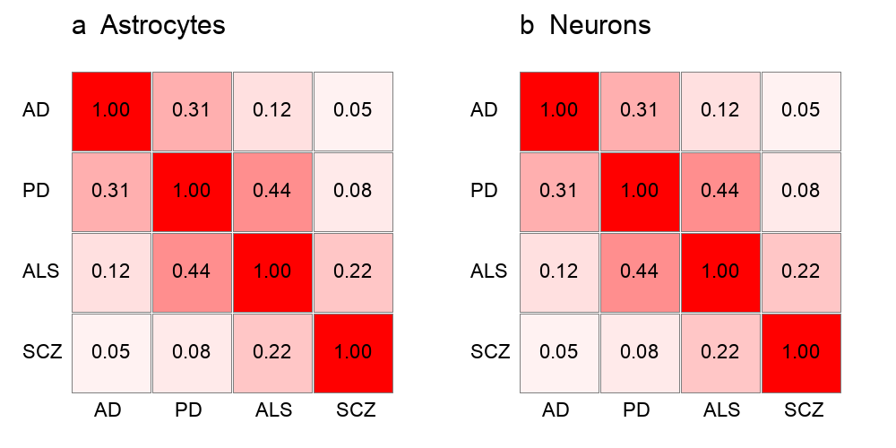
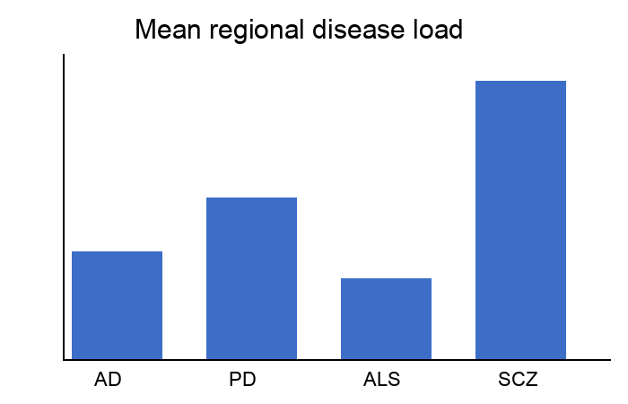

# Shared transcriptional programs across four brain disorders

Disorders share transcriptional programs, but the overlap depends on cell type. Astrocytes and neurons show different patterns of cross-disorder similarity (Figure 1).

**Figure 1. Cross-disorder similarity differs between cell types.** Kendall correlation of disease gene modules in (a) astrocytes and (b) neurons. In neurons, PD and ALS are the most similar pair (𝛕 = 0.81), while astrocytes show weak similarity throughout.

PD carries the highest regional disease load of the four disorders (Fig. 2).

**Figure 2. Mean regional disease load by disorder.** PD shows the highest load, followed by SCZ.
